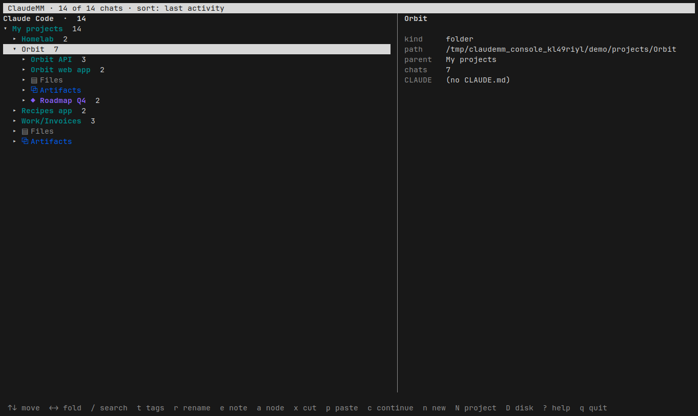
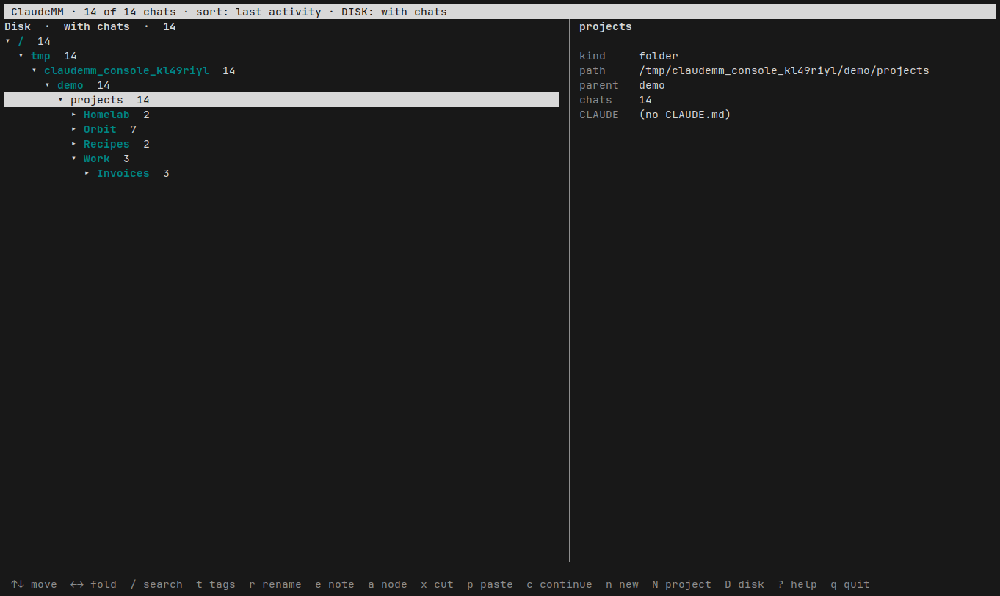
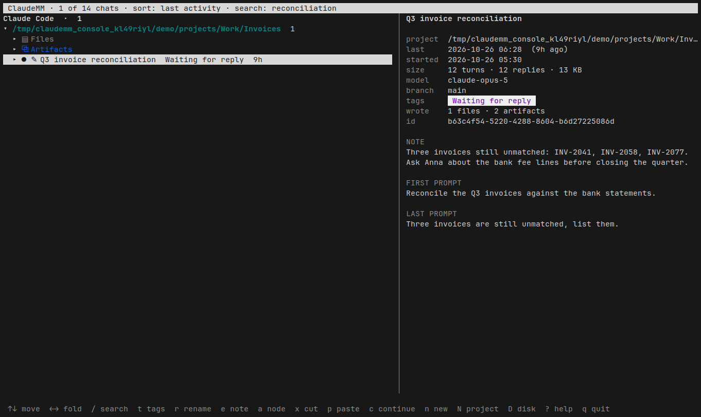
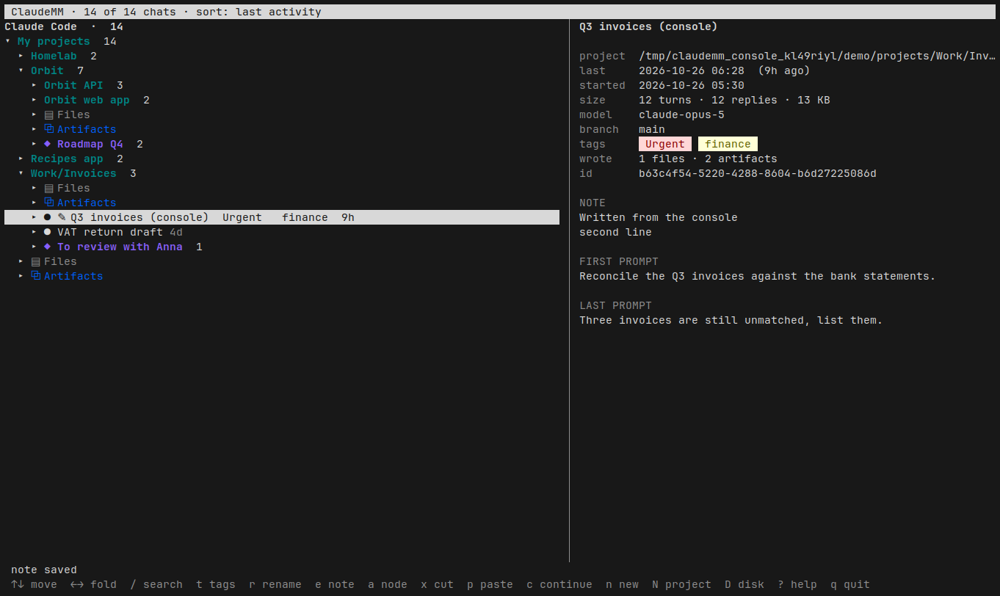
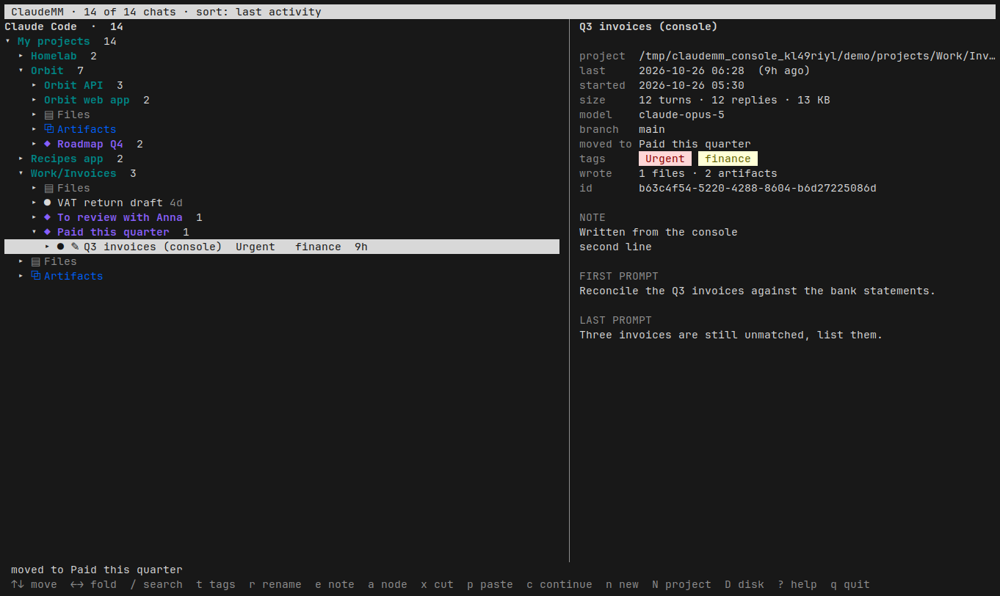
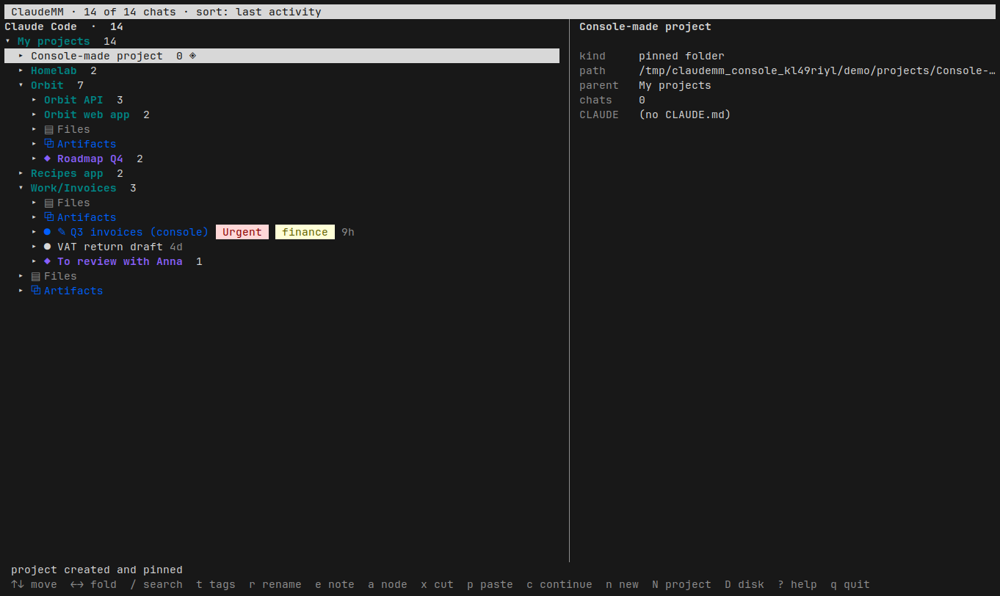

# ClaudeMM in a terminal

`ClaudeMMConsole` shows the ClaudeMM mind map as an outline in a terminal, on
Linux and Windows. It is the same tree as the window: the disk folders with
their aliases, the manual nodes, the chats you moved, notes, the files a chat
wrote, artifacts and web servers. Its edits go to the same files under
`~/.config/ChronoUI` (Linux) or `%APPDATA%\ChronoUI` (Windows), so the window
and the console can be open at the same time.

## Keys

| Key | What it does |
|---|---|
| `↑` `↓` `PgUp` `PgDn` `g` `G` | move |
| `→` / `←` | unfold / fold (or climb to the parent) |
| `Enter`, `Space` | fold or unfold |
| `/` | search titles, prompts, tags, notes and project paths; `Esc` clears |
| `t` | a chat's tags, comma separated |
| `r` | rename a chat, a manual node, or set a folder's alias (empty clears) |
| `e` | the note of a chat, folder or node, in `$EDITOR` (multi-line) |
| `a` | a new manual node under the current folder or node |
| `x`, then `p` | move a chat or a manual node: cut, then paste on its new place |
| `d` | delete a manual node (its chats go back to their folders) |
| `c` | continue the chat: `claude --resume` in its folder, back here on exit |
| `n` | a new chat in the current folder |
| `N` | a new project: create the folder, pin it in the map, start `claude` there |
| `D` | the disk explorer (and back to the map) |
| `A` | in the disk explorer: every folder, or only those with chats below |
| `o` | open the folder, file or URL |
| `s` | start or stop a web server |
| `S`, `H`, `z`, `Z`, `R` | sort, show/hide empty chats, fold all, unfold all, rescan |
| `q` | quit |

Locating a project or a chat is a search away: `/` narrows the tree to the
hits and the folders above them, and `Esc` brings the whole tree back with the
cursor still on what you picked.

## The disk explorer

`D` swaps the map for the real folders on disk, from `/` (Linux) or the drives
(Windows), opened down to your home folder. The branches that lead to chats
are listed first, in colour, with the number of chats below them; the rest are
dimmed. `A` switches between every folder and only the branches with chats,
where a folder with a single branch unrolls by itself. It is the disk as it is:
no aliases, manual nodes or moved chats, so cutting, pasting and new nodes stay
in the map; tags, notes, renames, `c`, `n` and `N` work here too. The window
has the same explorer behind its `▤ Disk` button, with `All folders` /
`With chats` beside it.

## How it fits

- `include/MapTree.hpp` builds the tree; the window's `VMindMap` inherits it,
  so the rules about anchored folders, moved chats and hidden empty nodes are
  written once.
- `include/Term.hpp` is the terminal: raw keys, the alternate screen, ANSI
  colours, termios on Linux and a VT-mode console on Windows.
- Every edit reloads the store from disk just before writing (the window or
  the MCP server may have written meanwhile), and the console notices when
  another process changed `claudemm_tags.tsv` or `claudemm_map.tsv` and
  reloads within a second. It never writes `claudemm_view.tsv` or the scan
  cache.

## Building and testing

    cmake -S . -B build-linux -G Ninja -DCMAKE_BUILD_TYPE=Release -DCHRONOUI_CLAUDEMM_LINUX=ON
    cmake --build build-linux --target ClaudeMMConsole
    python3 ClaudeMM/tools/test_console.py --exe build-linux/Release/ClaudeMMConsole

The test builds the synthetic data set (`tools/make_demo.py`) in a temporary
folder, drives the console through tmux and checks the screen and the TSV files
after every step: search, tags, rename, note, new node, move, delete, new
project, the disk explorer, quit. `--shots ClaudeMM/docs/console` also retakes the screenshots
above (Alacritty in Xvfb, `xwd`, ImageMagick).
